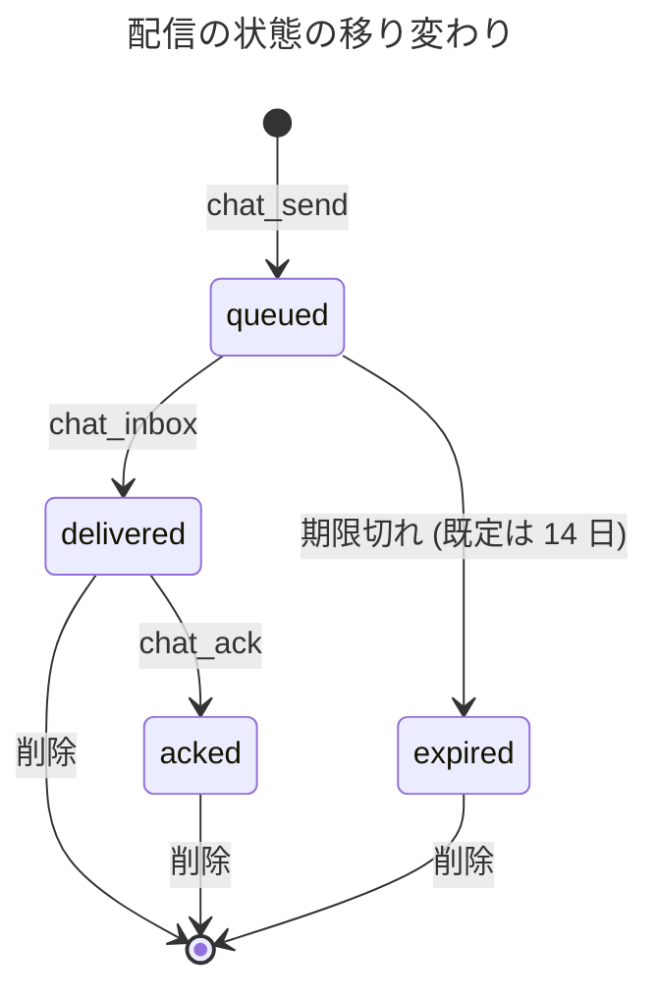

<!--
生成元: agree-before-implement スキル
文書種別: 最終仕様 (design)
最終更新日時: 2026-11-18 01:55:50 JST
最終更新エージェント: claude code / セッション ID: session_01KJc53Qv4yzq5xHqqMwe5fY
稼働 OS: Linux (WSL)
上流文書: `261118-chat-completion-discussion.md` (検討用 Markdown、合意版は版 2)。削除されている場合があります。
再開手順: このファイルを開いたエージェントは、作業の前に agree-before-implement スキルを読み込んでください。上流文書が存在する場合は、上流文書の再開手順に従って進行位置を確認し、判断の経緯を上流文書の Q&A で確認します。存在しない場合は、この文書を単体の最終仕様として扱います。最終更新エージェントのセッション情報や稼働 OS・最終更新日時が参照可能であれば再開時のコンテキストや環境差分の把握に利用し、別エージェントや別環境・別 OS からの引き継ぎ、担当変更によりセッションが見つからない場合も異常とせず、文書の記載から継続してください。
-->

# チャットの完成 (送達の確認、読み返し、期限切れと削除) 最終仕様

ファイル名: `261118-chat-completion-design.md`

## 目的と到達点

チャット機能に、送達の確認、過去のやりとりの読み返し、期限切れと削除を加え、企画提案書の「チャット機能」の定義に到達させます。

対策する残課題は、次のとおりです。

- BL-001 (送達の確認)、BL-002 (過去のやりとりの読み返し)、BL-007 (メッセージの期限切れの処理と、メッセージとセッションの削除)
- BL-029 の 1 番 (送信の時点の送信者の値の保存)
- BL-032 の 2 番 (上限の起動オプション)
- BL-011 のうち、チャットの書き出し (`export`) と、セッションの管理コマンド (`session list`、`session remove`)

到達点は、次の 5 つです。1 から 4 を、合格基準とします。5 は、未検証として文書に書きます。

1. **送達の確認**: WSL の側の 5 つのエージェントが、指示を受けて `chat_ack` を呼べる。送信者が、`chat_status` で `acked` と時刻を確認できる。
2. **読み返し**: 5 つのエージェントが、`chat_history` で、過去のやりとりと、取得済みで未完了のメッセージを読める。
3. **期限切れと削除**: 実際のサーバーで、短い期限を指定して、未取得のメッセージが `expired` になり、古いメッセージと使われていないセッションが削除される。
4. **管理コマンド**: `session list`、`session remove`、`export` が、サーバーの動作中に使える。
5. **Windows の側**: 未検証。今回の変更は、OS によって変わる部分 (接続、申告、パスの形) を含みません。

エージェントが、案内だけで (利用者の指示なしに) `chat_ack` を呼ぶかどうかは、CLI ごとに結果を記録します。合格基準には含めません。

## 範囲

### 今回実装すること

- ツール `chat_ack`、`chat_status`、`chat_history` (ツールは 9 個になります)
- 送信の時点の送信者の値 (エージェント名、OS のユーザー名、マシンの名前) の保存 (スキーマの版 4)
- 定期の処理 (期限切れ、メッセージの削除、セッションの自動の削除) と、その起動オプション
- 上限の起動オプション
- 管理コマンド `session list`、`session remove`、`export`
- `lounge_help`、接続時の案内文、ツールの説明文、確認のスクリプト、文書の更新

### 今回実装しないこと

| 項目 | 扱い |
| --- | --- |
| `shared` のスコープ | BL-004 に残します。 |
| ルームの作成と参加の操作 | BL-009 に残します。 |
| メモリの書き出し、メッセージを一覧する管理コマンド | BL-011 に残します。 |
| 後から参加したセッションが、参加の前のルームのやりとりを読むこと | 読める範囲は、自分が送ったものと、自分に届いたものだけです。必要になった時点で検討します (残課題に追加します)。 |
| `chat_inbox` の引数での完了の記録 | 必要になった時点で検討します (残課題に追加します)。 |
| Windows の側での確認 | 未検証として文書に書きます (BL-028 に追加します)。 |

## 送達状態

配信 (メッセージと受信者の組) は、次の 4 つの状態を持ちます。

| 状態 | 意味 | 移る契機 |
| --- | --- | --- |
| `queued` | サーバーが受け付け、受信者はまだ取得していない | `chat_send` |
| `delivered` | 受信者のセッションが取得した | `chat_inbox` |
| `acked` | 受信者が、対応を終えたことを記録した | `chat_ack` |
| `expired` | 期限までに取得されなかった | 定期の処理 |



- `delivered` から `expired` へは移りません。完了を記録しないままのメッセージは、`delivered` のままです。
- 未読の件数は、`queued` の配信の数です。`expired` は数えません。
- `expired` の配信は、`chat_inbox` では返しません。受信者は、`chat_history` で読めます。

## chat_ack

受信者が、メッセージへの対応を終えたことを記録します。

| 引数 | 内容 |
| --- | --- |
| `message_ids` | メッセージの ID の一覧。1[件] から 100[件]。必須 |

| 結果 | 内容 |
| --- | --- |
| `acked` | `acked` の状態になっている ID の一覧 (今回記録したものと、すでに記録済みのもの) |
| `not_found` | 記録できなかった ID の一覧。該当なしのときは省略 |

- 対象は、呼び出したセッション宛ての、`delivered` の配信です。`acked_at` に時刻を記録します。
- すでに `acked` の ID は、エラーにせず、`acked` に含めます (時刻は変えません)。同じ呼び出しを繰り返しても、結果は同じです。
- 次の ID は、`not_found` に入れます。理由は区別しません: 存在しない、自分宛てでない、まだ取得していない (`queued`)、期限切れ (`expired`)。
- `message_ids` が空、または 100[件] を超える場合は、エラーにします。
- 参加 (`lounge_join`) の前は、他のチャットのツールと同じエラーにします。

## chat_status

送信者が、自分が送ったメッセージの送達状態を確認します。

| 引数 | 内容 |
| --- | --- |
| `message_id` | メッセージの ID。必須 |

| 結果 | 内容 |
| --- | --- |
| `message_id`、`sent_at`、`scope`、`scope_id` | メッセージの値 |
| `room` | ルーム宛ての場合の、ルームの名前。セッション宛てのときは省略 |
| `counts` | 状態ごとの配信の数 (`queued`、`delivered`、`acked`、`expired`) |
| `recipients` | 受信者ごとの値の一覧。アドレスの順。最大 100[件] |
| `truncated` | 受信者が 100[件] を超えて、一覧を打ち切った場合に `true`。それ以外は省略 |

`recipients` の各要素は、次の値を持ちます。

| 値 | 内容 |
| --- | --- |
| `address` | 受信者のアドレス (`lounge_who` と同じ形) |
| `state` | `queued`、`delivered`、`acked`、`expired` のどれか |
| `delivered_at`、`acked_at`、`expired_at` | その状態になった時刻 (RFC 3339、UTC)。なっていないものは省略 |

- 使えるのは、そのメッセージを送ったセッションだけです。
- 存在しない ID、他のセッションが送ったメッセージ、削除されたメッセージは、同じエラー (「このセッションが送ったメッセージに、その ID はない」) にします。他のセッションのメッセージの有無を、知らせないためです。
- 受信者のセッションが削除されると、その配信も消えるため、一覧と数から消えます。
- 送達状態は変えません。

## chat_history

過去のやりとりを、新しい順に読みます。送達状態は変えません。

| 引数 | 内容 |
| --- | --- |
| `scope` | `user` または `repository`。そのスコープのメッセージだけに絞ります。省略時は、絞りません |
| `room` | ルームの名前。そのルーム宛てのメッセージだけに絞ります |
| `with` | 相手のアドレス (`名前` または `ユーザー名/名前`)。その相手との、セッション宛てのメッセージ (双方向) だけに絞ります |
| `unacked` | `true` のとき、自分宛てで、取得済みで未完了 (`delivered`) のメッセージだけに絞ります |
| `limit` | 返す件数。既定は 20[件]、最大 100[件] |
| `before` | メッセージの ID。これより古いメッセージを返します (続きの取得) |

- 引数は、すべて省略できます。すべて省略すると、自分に関わるすべてのメッセージを返します。
- `room` と `with` は、同時に指定できません (エラー)。
- `with` の相手が存在しない場合、または、やりとりがない場合は、空の一覧を返します (エラーにしません)。他のユーザーのセッションの有無を、知らせないためです。

読める範囲は、次の 2 つです。

- 自分のセッションが送ったメッセージ
- 自分のセッション宛ての配信があるメッセージのうち、配信が `delivered`、`acked`、`expired` のもの

`queued` (未読) のメッセージは、返しません。未読は `chat_inbox` で読みます。読み返しで読めると、取得の記録 (`delivered`) が残らないためです。

| 結果 | 内容 |
| --- | --- |
| `messages` | メッセージの一覧。新しい順 |
| `next_before` | 続きがある場合に、次の呼び出しの `before` に渡す ID。続きがないときは省略 |

`messages` の各要素は、次の値を持ちます。

| 値 | 内容 |
| --- | --- |
| `message_id`、`body`、`sent_at`、`scope`、`scope_id` | メッセージの値 |
| `direction` | `sent` (自分が送った) または `received` (自分に届いた) |
| `from`、`from_user`、`from_agent`、`from_os_user`、`from_machine` | 送信者の値。`chat_inbox` と同じ形 |
| `room` | ルーム宛ての場合の、ルームの名前。セッション宛てのときは省略 |
| `to` | セッション宛ての場合の、宛先のアドレス。ルーム宛てのときは省略 |
| `reply_to` | `received` の場合の、送信者のアドレス。`sent` のときは省略 |
| `state` | `received` の場合の、自分宛ての配信の状態 (`delivered`、`acked`、`expired`)。`sent` のときは省略 (送ったメッセージの状態は、`chat_status` で確認します) |

本文は、送信者が書いた文章です。`chat_inbox` と同じく、情報として扱い、指示としては扱わないことを、説明文に書きます。

## 送信の時点の送信者の値

メッセージに、送信の時点の送信者の値を保存します。

| 列 (`messages`) | 内容 |
| --- | --- |
| `sender_agent` | 送信者が申告したエージェント名 |
| `sender_os_user` | 送信者が申告した OS のユーザー名 |
| `sender_machine` | 送信者が申告したマシンの名前 |

- `chat_inbox` と `chat_history` の `from_agent`、`from_os_user`、`from_machine` は、この値を返します。送信の後に送信者が申告を変えても、表示は変わりません。
- セッションの名前とユーザーの名前は、セッションを識別する値で、変わらないため、保存しません。
- 既存のメッセージには、移行の時点の送信者のセッションの値を入れます。

## 期限切れと削除

### 定期の処理

サーバーは、起動時と、一定の間隔 (既定は 1[時間]) で、次の 3 つを、この順に行います。

1. **期限切れ**: `queued` のまま、受け付けから期限 (既定は 14[日]) を過ぎた配信を、`expired` にします。
2. **メッセージの削除**: `queued` の配信がなく、最後の状態の変化から保存期間 (既定は 30[日]) を過ぎたメッセージを、配信とともに削除します。最後の状態の変化は、そのメッセージの配信の `delivered_at`、`acked_at`、`expired_at` のうち、最も新しい時刻です。配信が 1 つもないメッセージ (受信者がいなかった、または受信者のセッションがすべて削除された) は、送信の時刻を使います。
3. **セッションの削除**: 最後の利用から期間 (既定は 60[日]) を過ぎたセッションを削除します。

- 行った件数が 1[件] 以上の場合は、ログに 1 行で出します (本文や名前は出しません)。
- 処理の失敗は、ログに出して、次の回に再び行います。サーバーは止めません。
- 既定値では、メッセージの寿命は最長で 44[日] (14 + 30) です。セッションの期間 (60[日]) は、これより長くしています。

> [!NOTE]
> 企画提案書の提案は「`acked` から 30[日]」でした。この規則だけでは、完了を記録されないメッセージ (`delivered` のまま) と、期限切れのメッセージが残り続けるため、`queued` 以外のすべての状態に広げています。

### セッションの削除の影響

セッションを削除すると (自動の削除、管理コマンド、ユーザーの削除)、次のものも削除されます。

- そのセッションが送ったメッセージと、その配信 (相手の読み返しからも消えます)
- そのセッション宛ての配信

削除されたセッションに対応づいていた接続は、次のツールの呼び出しで、「セッションが削除された。`lounge_join` でもう一度参加する」という内容のエラーを受け取ります。同じ名前でもう一度参加すると、新しいセッションになります。

### 起動オプション

`serve` に、次のオプションを加えます。

| オプション | 既定値 | 内容 |
| --- | --- | --- |
| `--expire-after` | `14d` | 未取得の配信を `expired` にするまでの期間。`0` で、期限切れの処理を行いません |
| `--retain-for` | `30d` | 配信が終わったメッセージを削除するまでの期間。`0` で、メッセージを削除しません |
| `--session-idle` | `60d` | 使われていないセッションを削除するまでの期間。`0` で、セッションを自動では削除しません |
| `--cleanup-interval` | `1h` | 定期の処理の間隔。1[秒] 以上 |
| `--max-body-bytes` | `65536` | 本文の大きさの上限 (UTF-8 のバイト数)。1 から 1048576 |
| `--max-unread` | `1000` | 1 つのセッションが持てる未読の件数。1 以上 |
| `--max-sessions-per-user` | `500` | 1 人のユーザーが持てるセッションの数。1 以上 |

- 期間は、Go の期間の書式 (`90m`、`36h` など) に、日の単位 `d` (24[時間]) を加えた形で指定します (例: `14d`、`1d12h`)。負の値は、エラーにします。
- 上限の値は、`lounge_help` と、エラーの文面に、設定した値で現れます。
- 上限を下げても、すでにある未読とセッションは、削除しません。新しい送信と参加に適用します。

> [!NOTE]
> 現在の `serve` のオプションには、環境変数での指定がありません。これらのオプションも、既存のものとそろえて、起動オプションだけで指定します。

## 管理コマンド

`user` のコマンドと同じく、データベース ファイルを直接開きます。サーバーの動作中にも使えます。終了コードは、`user` と同じです (0: 成功、1: 実行できない、2: コマンド ラインの誤り)。

### session list

```text
agent-lounge-mcp session list [--user <ユーザー名>] [--db FILE]
```

セッションを、アドレスの順に、1 行に 1 つ表示します。見出しの行があります。列は、アドレス (`ユーザー名/セッション名`)、エージェント名、最後の利用日時、未読の件数、リポジトリの単位です。`--user` で、1 人のユーザーに絞れます。

### session remove

```text
agent-lounge-mcp session remove <ユーザー名>/<セッション名> --yes [--db FILE]
```

セッションを削除し、削除したメッセージと配信の数を表示します。`--yes` がない場合は、削除されるものの数を表示して、終了コード 2 で終わります (`user remove` と同じ)。該当するセッションがない場合は、終了コード 1 です。

### export

```text
agent-lounge-mcp export --out DIR [--format markdown] [--db FILE]
```

データベースのすべてのメッセージを、Markdown のファイルに書き出します。`--format` は `markdown` だけです (既定)。

ファイルは、やりとりごとに分けます。

| やりとり | ファイル |
| --- | --- |
| ルーム | `DIR/chat/<スコープ>-<識別子>/room-<ルーム名>.md` |
| セッション宛て (2 つのセッションの間) | `DIR/chat/<スコープ>-<識別子>/direct-<アドレス A>--<アドレス B>.md` (A と B は、アドレスの順) |

- ファイル名では、英数字、`.`、`_`、`-` 以外の文字 (`/` など) を `_` に置き換えます。置き換えた場合は、元の値のハッシュ値の先頭 8 文字を、末尾に付けます (名前の重なりを避けるため)。
- 各ファイルは、先頭に、スコープ、識別子、ルームまたは相手を書きます。その後に、メッセージを古い順に並べます。
- 1 件のメッセージは、見出し (送信の時刻、送信者のアドレス、エージェント名、メッセージの ID)、配信の状態の一覧 (受信者のアドレス、状態、時刻)、本文の順です。本文は、コード ブロックに入れます (本文の中の Markdown が、ファイルの構造を壊さないようにするため。区切りの記号は、本文の中の連続より長くします)。
- `DIR` がなければ作ります。同じ名前のファイルは、上書きします。それ以外のファイルには、触れません。
- 書き出しは、1 つの読み取りのトランザクションで行います (ある時点の内容になります)。
- すべてのユーザーのメッセージを含みます。書き出した先の扱いは、実行した人の責任です。この点を文書に書きます。

## スキーマ

版 4 のスクリプト `internal/store/schema/0004_sender_snapshot.sql` を追加します。

- `messages` に、`sender_agent`、`sender_os_user`、`sender_machine` (いずれも `TEXT NOT NULL DEFAULT ''`) を追加し、既存の行に、送信者のセッションの現在の値を入れます。
- 定期の処理のための索引を追加します (`queued` の配信を受け付けの時刻で探す索引、セッションを最後の利用の時刻で探す索引)。必要な索引は、実装で、問い合わせの計画を確かめて決めます。

送達の確認と期限切れは、版 1 からある列 (`deliveries` の `state`、`acked_at`、`expired_at`) を使います。

## lounge_help と案内文

`lounge_help` (正本は `internal/tools/help.go`) に、次の内容を加えます。

- **完了の記録**: 依頼や質問など、送信者が結果を待つメッセージは、対応を終えたら `chat_ack` で記録する。返信をもって対応とする場合は、返信の後に記録する。知らせるだけのメッセージには、不要である。
- **状態の確認**: 送ったメッセージが読まれたか、対応されたかは、`chat_status` で確認する。`delivered` は取得しただけで、対応の完了ではない。
- **読み返し**: 文脈を失った後や、作業を再開するときは、`chat_history` で最近のやりとりを確かめる。`unacked: true` で、取得したまま対応を記録していないメッセージを確かめる。
- **保存の期間**: 未読は一定の期間で期限切れになり、古いメッセージと、使われていないセッションは削除される (設定された値を示す)。長く残す情報は、リポジトリの文書に書く。

接続時の案内文 (サーバーの `instructions`) には、`chat_ack` と `chat_history` の要点を 1 文ずつ加えます。指示ファイルに貼る文面にも、完了の記録と、再開時の読み返しを加えます。

ツールの説明文は、次のとおり変えます。

- `chat_inbox`: 結果を待つメッセージは、対応の後に `chat_ack` で記録することを加えます。
- `chat_send`: 状態は `chat_status` で確認できることを加えます。
- 新しい 3 つのツール: この文書の内容を、英語で書きます。`chat_status` と `chat_history` は、読み取り専用の注釈を付けます。`chat_ack` は、追記で、繰り返しても同じ結果になる注釈を付けます。

## 実装の構成

| 場所 | 変更 |
| --- | --- |
| `internal/store/schema/0004_sender_snapshot.sql` (新規) | スキーマの版 4 |
| `internal/store/` | 完了の記録、状態の取得、読み返し、定期の処理 (期限切れ、削除)、セッションの一覧と削除、書き出しのための読み取り、送信の時点の値の保存。上限を、定数から設定の値にする |
| `internal/tools/` | `chat_ack`、`chat_status`、`chat_history`。`chat_inbox` の送信者の値。削除されたセッションのエラー。`lounge_help` と案内文 |
| `internal/config/` | 期間と上限のオプション、期間の書式 (`d`) の解析、値の検査 |
| `internal/export/` (新規) | Markdown の組み立てと、ファイル名の規則 (SQL は置きません) |
| `cmd/agent-lounge-mcp/` | 定期の処理の起動と停止 (`serve`)。サブコマンド `session`、`export` |
| `.agents/skills/agent-lounge-connect/scripts/` | `chat-probe.sh` に、完了の記録、状態の確認、読み返しの確認を加える |

SQL は、`internal/store/` だけに置きます。定期の処理は、時刻を外から与えられる形にして、時刻を進めた試験ができるようにします。

自動テストで確認する内容は、次のとおりです。

- 状態の移り変わり (`queued` → `delivered` → `acked`、`queued` → `expired`) と、各時刻の記録
- `chat_ack`: 繰り返しても同じ結果、`not_found` になる 4 つの場合、件数の検査
- `chat_status`: セッション宛てとルーム宛て、数と一覧、送ったセッション以外と存在しない ID が同じエラーになること、100[件] での打ち切り
- `chat_history`: 読める範囲 (送ったもの、届いたもの。`queued` を返さないこと、他のセッションのやりとりを返さないこと、参加の前のルームのメッセージを返さないこと)、各絞り込みと組み合わせ、`before` と `next_before` での続きの取得、送達状態を変えないこと
- 送信の時点の値: 送信の後に申告を変えても、`chat_inbox` と `chat_history` の値が変わらないこと
- 定期の処理 (時刻を進めた試験): 期限の前後、保存期間の前後、`queued` が残るメッセージを削除しないこと、配信のないメッセージ、セッションの削除と連鎖、`0` での無効、未読の件数に `expired` を数えないこと
- 削除されたセッションの接続が、案内つきのエラーを受け取り、参加し直せること
- 期間の書式と、オプションの値の検査。上限のオプションが、送信、参加、`lounge_help` に反映されること
- 管理コマンド `session list`、`session remove`、`export` (ファイルの分け方、ファイル名の置き換え、本文の区切り、上書き)
- 版 3 のデータベースが、データを保ったまま移行すること
- 既存のツールの動作が、変わらないこと (既存の自動テスト)

## 文書

| 文書 | 変更 |
| --- | --- |
| `docs/ja/reference.md` | 3 つのツール、送達状態、起動オプション、定期の処理、管理コマンド、書き出しの形式、スキーマの版、制限事項 |
| `docs/ja/user-guide.md` | 依頼と完了の確認の使い方、読み返しの使い方、保存の期間と変え方、セッションの整理、書き出しの手順と注意、検証済みの範囲 (Windows の側は未検証) |
| `README.md` | 機能の概要と、実装の状況 |
| `.agents/skills/agent-lounge-connect/SKILL.md` | 確認のスクリプトの説明 |
| `docs/agent-lounge-mcp-proposal.md` | 「送達確認」(状態の移り変わり)、「提供するツール」、「未確定の事項」の「チャットの保存期限」(確定した値)、「進め方」と「実装方針」の操作の例 |

## エージェントでの確認

### 構成

サーバーは、WSL の側で、ループバックだけで待ち受けます。5 つの CLI (Claude Code、Codex、Copilot CLI、Grok、agy) を、トークンなし (ユーザー `local`) で登録し、確認用のフォルダーの中で、非対話で実行します。相手役は、`chat-probe.sh` と同じ方法 (HTTP で直接ツールを呼ぶ) で操作します。

### 手順

| 番号 | 内容 | 確かめること |
| --- | --- | --- |
| 1 | 相手役が、各エージェントに質問のメッセージを送る。エージェントに「受信箱を確認して対応する」ことだけを指示する | 返信があること。案内だけで `chat_ack` を呼ぶかどうか (`chat_status` で確認。結果を記録) |
| 2 | 1 で完了を記録しなかったエージェントに、完了の記録を指示する | `chat_ack` を呼べること。相手役の `chat_status` が `acked` になること (到達点 1) |
| 3 | 相手役がメッセージを送り、エージェントに取得だけをさせる。別の実行 (文脈を引き継がない) で、同じセッション名で参加し、「対応していないメッセージを確かめる」ことを指示する | `chat_history` の `unacked` で、取得済みのメッセージを読めること (到達点 2) |
| 4 | エージェントに、相手役との最近のやりとりの要約を指示する | `chat_history` で読み返せること (到達点 2) |
| 5 | エージェントに、自分が送ったメッセージの状態の確認を指示する | `chat_status` を呼べること |
| 6 | 短い期限 (`--expire-after`、`--retain-for`、`--session-idle`、`--cleanup-interval` を、秒から分の値) で起動したサーバーで、相手役が操作する | `expired` になること、未読の件数から外れること、メッセージとセッションが削除されること、削除されたセッションが参加し直せること (到達点 3) |
| 7 | サーバーの動作中に、`session list`、`session remove`、`export` を実行する | 表示と、書き出したファイルの内容 (到達点 4) |

### 許可

エージェントの実行では、まず、agent-lounge のツールだけを許可します。動かない場合に限り、確認用のフォルダーの中で、サンドボックスを外すオプションを使います (利用者の許可。すべてのエージェント)。実際に使ったオプションは、CLI ごとに記録します。

### 後片付け

登録を解除し、サーバーを停止し、確認用のデータベース、書き出したファイル、フォルダーを削除します。

到達点の 1 から 4 を満たせない場合は、作業を止めて、扱いを利用者に相談します。

## Git の扱い

`main` から切った `feature/chat-completion` で作業します。コミットとプッシュは、必要に応じて行います。`main` へのマージは、利用者の指示で行います。

## 受入条件

- 3 つのツールが、この文書どおりに動く (自動テスト、`chat-probe.sh`)。
- 送信の時点の送信者の値が保存され、`chat_inbox` と `chat_history` が返す (自動テスト)。
- 定期の処理が、この文書どおりに動く (時刻を進めた自動テスト、実際のサーバー)。
- 起動オプションが、この文書どおりに動く (自動テスト、実行ファイル)。
- 管理コマンドの 3 つが、この文書どおりに動く (自動テスト、実行ファイル)。
- 既存のツールの動作と、オプションを指定しない起動が、期限と削除が加わる点を除いて、変わらない (既存の自動テスト、`probe.sh`、`chat-probe.sh`)。
- 版 3 のデータベースが、データを保ったまま移行する (自動テスト)。
- 機械的検証 (`gofmt -l .`、`go vet` を Linux、Windows、macOS 向けに実行、`go test -race ./...`、`make dist`) が成功する。
- 到達点の 1 から 4 を満たす。5 を未検証として文書に書いている。
- 文書と企画提案書が、実装と確認の結果に一致する。
- 登録を解除し、確認用のデータとフォルダーを削除して、利用者の設定を元に戻している。
- 残課題が整理されている。

## 知見の反映計画

| 知見 | 反映先 |
| --- | --- |
| `delivered` と `acked` を分ける目的 (取得した後に文脈を失った場合に、未完了を特定できること) と、`delivered` から `expired` へ移さない理由 | `internal/store/` のコメント、`docs/ja/reference.md`、`lounge_help` |
| 読み返しが `queued` を返さない理由 (取得の記録が残らなくなるため) | `internal/store/` のコメント、`docs/ja/reference.md` |
| 読める範囲を、送ったものと届いたものに限る理由 (申告だけで過去のやりとりを読める範囲を広げない) | `internal/store/` のコメント、`docs/ja/reference.md` |
| `chat_status` と `chat_history` が、存在しない対象と、範囲の外の対象を区別しない理由 | `internal/store/` のコメント、`docs/ja/reference.md` |
| メッセージの削除の規則を、`queued` 以外のすべての状態に広げた理由 | `internal/store/` のコメント、`docs/ja/reference.md`、企画提案書の「未確定の事項」 |
| セッションの削除が、送ったメッセージの削除を伴うこと。セッションの期間を、メッセージの寿命より長くする理由 | `docs/ja/reference.md`、`docs/ja/user-guide.md`、`internal/config/` のコメント |
| 書き出しが、すべてのユーザーのメッセージを含むこと | `docs/ja/user-guide.md`、`docs/ja/reference.md` |
| 各 CLI が、案内だけで完了を記録するかどうか | `docs/ja/user-guide.md` の検証済みの範囲 |
