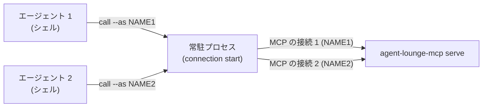

<!--
生成元: agree-before-implement スキル
文書種別: 最終仕様 (design)
最終更新日時: 2026-11-23 10:35:00 JST
最終更新エージェント: claude code / セッション ID: session_01KJc53ReNCYHwdPaqjNwsEV
稼働 OS: Linux (WSL)
上流文書: `261123-backlog-batch-overview.md` (全体管理文書)、`261123-backlog-batch-discussion.md` (検討用 Markdown)、`261123-backlog-batch-lightadr.md` (簡易 ADR)。いずれも削除されている場合があります。
下流文書: `261123-backlog-batch-backlog.md` (残課題一覧)、`261123-backlog-batch-validation.md` (確認の記録)。未作成の場合や、削除されている場合があります。
再開手順: このファイルを開いたエージェントは、作業の前に agree-before-implement スキルを読み込んでください。上流文書の全体管理文書が存在する場合は、その再開手順に従って作業 WBS の `← **CURRENT**` の項目から再開します。存在しない場合は、この文書を単体の最終仕様として扱い、承認の状態をユーザーに確認してください。最終更新エージェントのセッション情報や稼働 OS・最終更新日時が参照可能であれば再開時のコンテキストや環境差分の把握に利用し、別エージェントや別環境・別 OS からの引き継ぎ、担当変更によりセッションが見つからない場合も異常とせず、文書の記載から継続してください。
-->

# 残課題の一括対策 (WSL で進められる項目) 最終仕様

ファイル名: `261123-backlog-batch-design.md`

## 1. 目的と範囲

### 1.1. 目的

残課題のうち、WSL の環境だけで進められる項目を一括で対策します。リリースの前であるため、変更の小ささを採用の理由にせず、企画提案書 (`docs/agent-lounge-mcp-proposal.md`) の目的と要件に即した仕様にします。判断の基準にする目的と要件は、次の 4 点です。

- 種類とマシンを問わず、複数のエージェントが協調できること。
- メッセージが相手に届いたことを確認できること。
- リポジトリとブランチの空間で、別のリポジトリや別のブランチの内容と混ざらないこと。
- エージェントが、サーバー (CLI の方式では実行ファイル) が返す情報だけで、利用方法を確認できること。

### 1.2. 範囲

| 区分 | 課題 | 章 |
| --- | --- | --- |
| 実装する | BL-046 ブランチの名前の検査 | 2 |
| 実装する | BL-045 メモリのない活動行の削除 | 3 |
| 実装する | BL-014 セッション名とユーザー名の規則 | 4 |
| 実装する | BL-011 メッセージの一覧、表示、書き出しの絞り込み | 5 |
| 実装する | BL-034 空間の種類ごとの忘却の設定 | 6 |
| 実装する | BL-047 MCP を使わない CLI の方式 | 7 |
| 実装する | BL-035 の (17) 許可の画面への再応答の条件 | 8 |
| WSL で実機確認する | BL-044 の WSL の側、BL-040、BL-014、BL-047 | 9 |
| 取り下げる | BL-033 の (2)、BL-031 の (4) と (5)、BL-030 のうちサーバー自身の HTTPS | 10 |

次の項目は扱わず、残課題一覧に残します。BL-004、BL-009、BL-033 の (1)、BL-031 の (2)(3)(6)、BL-013、BL-028、BL-030 の別のマシンからの接続の検証、BL-036、BL-042、BL-044 の Windows の側、BL-035 の (17) 以外。

## 2. ブランチの名前の検査 (BL-046)

`profile.Branch` (`internal/profile/profile.go`) の検査を、次のとおりにします。

1. 申告の値を改行 (`\n`、`\r`) で行に分け、前後の ASCII の空白 (空白とタブ) を取り除いた結果が空でない最後の行を、名前にします。前後の ASCII の空白は取り除き、Unicode の空白 (全角空白 U+3000 など) は名前の一部として残します。共通の関数 `lastLine` は変えません。
2. 名前が空であれば、ブランチなしです (今と同じ)。
3. 名前が `HEAD` (大文字。小文字にそろえる前の値) であれば、エラーにします。`head` と `Head` は受け入れます。
4. 名前を小文字にそろえます (今と同じ)。
5. 長さ (255 文字まで) を検査します (今と同じ)。
6. ASCII の空白 (U+0020)、制御文字 (`unicode.IsControl`)、`:`、`~`、`^`、`?`、`*`、`[`、`\` を含む名前を、エラーにします。Unicode の空白は、エラーにしません。

Git が拒否する名前の構造 (`a..b`、`@{-1}`、`.lock` で終わる名前など) の検査は、足しません。

| 申告の値 (`␣` は ASCII の空白、`□` は全角空白) | 結果 |
| --- | --- |
| `a□b` | `a□b` |
| `□foo□` | `□foo□` |
| `␣foo␣`、`foo` + 改行、`foo` + CR LF | `foo` |
| `a␣b` | エラー |
| `HEAD` | エラー |
| `head`、`Head` | `head` |
| 空、改行だけ | ブランチなし |

Table: ブランチの名前の検査の例

## 3. メモリのない活動行の削除 (BL-045)

- 定期の処理 (メモリの削除と同じ処理) で、`memory_scope_activity` の行のうち、同じ `(scope, scope_id)` のメモリが 1 件もなく (固定したメモリ、薄れたメモリも数えます)、`last_access` から 60 日を過ぎた行を消します。メモリがないことの確認と削除は、1 つの文 (または同じトランザクション) で行います。
- 60 日は固定の値で、起動オプションは足しません。忘却の設定 (半減期 0、猶予期間 0 を含む) に関係なく消します。
- `user remove` は、ユーザーの削除と同じトランザクションで、そのユーザーの `user` のスコープの活動行を消します。
- 消した後に同じスコープへアクセスがあれば、行を作り直し、割引は 0 から始まります (メモリがないため、保持スコアに影響しません)。

## 4. セッション名とユーザー名の規則 (BL-014)

### 4.1. 規則

名前の検査と正規化に、RFC 8265 (PRECIS の利用者の名前の規則) を使います。実装は `golang.org/x/text/secure/precis` です (依存を 1 つ足します。C のコンパイラは要りません)。

| 項目 | セッション名 | ユーザー名 |
| --- | --- | --- |
| RFC 8265 の規則 | UsernameCasePreserved (大文字と小文字を区別する) | UsernameCaseMapped (小文字にそろえる) |
| 全角と半角 | そろえる (全角の英数字は半角に、半角カナは全角に) | 同じ |
| 正規化 | NFC | 同じ |
| 使える文字 | Unicode の文字、数字、結合記号 (規則が許すもの) と、ASCII の記号 `.`、`_`、`-`、`@` | 同じ |
| 使えない文字 | 空白、制御文字、上の 4 つ以外の ASCII の記号 (`/`、`:` など)、ASCII 以外の記号と句読点、絵文字、文脈の規則に合わない見えない文字、左右の向きが混ざる並び | 同じ |
| 長さ (正規化の後の文字の数) | 1 から 64 | 1 から 64 |
| 先頭の文字 | 制限なし | 制限なし |
| 予約 | なし | `local` (正規化の後の値で判定) |

Table: 名前の規則

- 検査の順は、(1) RFC 8265 の規則の適用 (正規化を含む)、(2) ASCII の記号が 4 つだけであることの確認、(3) 長さの確認、です。
- 保存と照合は、正規化の後の値で行います。サーバーが返す名前は、正規化の後の値です。入力と異なる場合があります (`レビュー担当２` は `レビュー担当2`、`ﾚﾋﾞｭｰ` は `レビュー`、ユーザー名の `Alice` は `alice`)。
- 今の規則で有効な名前 (ASCII の英数字と記号) は、すべてそのまま有効で、値も変わりません。データベースの移行は要りません。
- エラーの文は英語で、使える文字の規則を 1 文で示します (ライブラリのエラーの文は、そのまま返しません)。

### 4.2. 正規化を通す箇所

名前を受け取るすべての箇所で、同じ関数を通します。

- `lounge_join` の `name`。
- 宛先 (`chat_send` の `to` など) の `name` と `user/name`。`user` の部分はユーザー名の規則、`name` の部分はセッション名の規則で正規化してから照合します。
- 管理コマンドの引数 (`user add|rotate|expiry|remove` のユーザー名、`session remove` のユーザー名とセッション名、`--user` の絞り込み)。
- CLI の方式の参加者の名前 (`--as`。7 章)。

管理コマンドは、`-` で始まる名前を扱えるように、オプションの終わりを示す `--` を受け付けます (例: `user add -- -x`)。

### 4.3. 書き出しのファイル名

`export.SafeName` は、Unicode の文字、数字、結合記号と、`.`、`_`、`-` をファイル名に残します。それ以外の文字 (`/`、`:`、`@`、空白など) は、今と同じく `_` に置き換え、置き換えがあった場合に、元の名前のハッシュ値の先頭 8 桁を付けます。

## 5. メッセージの一覧、表示、書き出しの絞り込み (BL-011)

### 5.1. コマンド

```text
agent-lounge-mcp message list [絞り込み] [--state STATE] [--details] [--limit N] [--before-id ID] [--db FILE]
agent-lounge-mcp message show <ID> [--db FILE]
agent-lounge-mcp export [絞り込み] --out DIR [--db FILE]

絞り込み: [--user NAME] [--scope KIND [--scope-id ID]] [--since TIME] [--until TIME]
```

### 5.2. message list

- 1 メッセージを 1 行の、見出しの行が付いたタブ区切りの表で出します。列は、`ID`、`SENT` (送信の時刻。UTC の RFC 3339)、`FROM` (送信者の `user/name`)、`TO` (ルームの名前、または宛先の `user/name`)、`SCOPE`、`SCOPE_ID`、`QUEUED`、`DELIVERED`、`ACKED`、`EXPIRED` (その状態の送達の数) です。本文は出しません。
- 新しい順 (ID の降順) に出します。`--limit N` の既定は 100 です。`--before-id ID` は、ID がその値より小さいメッセージだけを出します。
- `--details` を付けると、各行の下に、受信者ごとの行 (字下げ、受信者の `user/name`、状態、その状態になった時刻) を出します。
- `--state queued|delivered|acked|expired` は、その状態の送達が 1 件以上あるメッセージを選びます。

### 5.3. message show

1 件のメッセージの、ID、送信者、宛先、スコープ、送信の時刻、受信者ごとの状態と時刻、本文を出します。ID のメッセージがない場合は、エラー (終了コード 1) にします。

### 5.4. 絞り込み

絞り込みは、`message list` と `export` で同じ意味です。複数を指定した場合は、すべてを満たす記録を選びます。

| オプション | メッセージ | メモリ (`export` だけ) |
| --- | --- | --- |
| `--user NAME` | 送信者、直接の宛先、送達先のいずれかがそのユーザー | スコープが `user` で識別子がそのユーザー、または作成者がそのユーザー |
| `--scope KIND` | スコープの種類が一致 | 同じ |
| `--scope-id ID` (`--scope` と組で指定) | スコープの識別子が一致 | 同じ |
| `--since TIME`、`--until TIME` (RFC 3339。`--since` 以上、`--until` 未満) | 送信の時刻 | 更新の時刻 |

Table: 絞り込みの意味

- `--user` は、保存されている名前で照合します。削除済みのユーザーの名前も指定できます。
- `--scope-id` を `--scope` なしで指定した場合、時刻の形式が誤っている場合は、使い方の誤り (終了コード 2) にします。
- 絞り込みを指定しない `export` の出力は、ファイル名の規則 (4.3) を除いて、今と同じです。絞り込んだ `export` は、選ばれた記録を含むファイルだけを書きます。出力先にある、以前に書き出した他のファイルは消しません。
- 既存の `memory list --scope` にも、`--scope-id` を足します。

## 6. 空間の種類ごとの忘却の設定 (BL-034)

### 6.1. 起動オプション

共通のオプション (`--memory-half-life`、`--memory-fade-threshold`、`--memory-grace`) を既定値として残し、種類ごとのオプションを足します。

```text
--memory-user-half-life DURATION        --memory-user-fade-threshold X        --memory-user-grace DURATION
--memory-repository-half-life DURATION  --memory-repository-fade-threshold X  --memory-repository-grace DURATION
--memory-branch-half-life DURATION      --memory-branch-fade-threshold X      --memory-branch-grace DURATION
```

- 種類ごとのオプションを指定しない項目は、共通の値を使います。項目ごとに引き継ぎます。
- `0` を明示した場合は、その種類だけ、忘却なし (半減期)、または薄れたメモリの自動の削除なし (猶予期間) になります。
- 値の検査 (範囲、形式) は、共通のオプションと同じです。

### 6.2. 適用

- メモリの保持スコア、薄れた状態の判定、削除、アクセスのない期間の割引の計算は、そのメモリのスコープの種類の設定で行います。計算式は変えません。
- 設定を変えて起動し直した場合、確定済みの割引はそのまま引き継ぎ、以後の計算に新しい値を使います。保持スコアと削除の判定が、起動し直しの前後で変わる場合があります (リファレンスに書きます)。
- `lounge_help` の忘却の説明と、`lounge_info` の設定の表示は、種類ごとの値が異なる場合に、種類ごとの値を示します。すべての種類が同じ値の場合は、今と同じ 1 つの説明にします。`lounge_help` の本文の大きさの上限は、変えません。

### 6.3. 設定の記録と管理コマンド

- スキーマの新しいスクリプト (`internal/store/schema/0008_memory_retention.sql`) で、有効な忘却の設定を記録するテーブルを足します。種類 (`user`、`repository`、`branch`) ごとに 1 行で、半減期、しきい値、猶予期間、記録の時刻を持ちます。
- サーバーは、起動の時点で、有効な設定をこのテーブルに書きます (前の記録を置き換えます)。
- 管理コマンド `memory list` は、このテーブルの記録を既定値に使います。オプション (共通の 2 つと、種類ごとのもの) を渡した場合は、その値を優先します。記録がないデータベース (サーバーを一度も起動していない) では、既定値を使います。`memory list` は、記録を書き換えません。

## 7. MCP を使わない CLI の方式 (BL-047)

### 7.1. 構成



Figure: CLI の方式の構成

- **常駐プロセス** (`connection start`): 利用者が、サーバーとユーザー (トークン) の組ごとに 1 回起動します。参加者の名前ごとに、サーバーへの MCP の接続 (Streamable HTTP) を 1 本ずつ持ちます。参加は接続に結び付くため、エージェントの呼び出しをまたいで保たれます。
- **CLI** (`call`、`tools`): エージェントがシェルから実行するたびに、手元の通信路で常駐プロセスにつなぎ、ツールを 1 回呼んで終わります。
- サーバーの側は変えません。常駐プロセスは、通常の MCP のクライアントとして接続します (Go SDK のクライアントを使います)。

### 7.2. コマンド

```text
agent-lounge-mcp connection start [--name NAME] [--detach] --url URL [--token-prompt | --token-stdin] [--idle-timeout DURATION]
agent-lounge-mcp connection status [--name NAME]
agent-lounge-mcp connection list
agent-lounge-mcp connection stop [--name NAME]
agent-lounge-mcp tools [--connection NAME] [--schema TOOL]
agent-lounge-mcp call [--connection NAME] [--as PARTICIPANT] [--json FILE] [--quiet] [--no-profile] TOOL [KEY=VALUE ...]
```

| 名前 | 意味 | 省略時 |
| --- | --- | --- |
| 常駐プロセスの名前 (`--name`、`--connection`) | 手元で常駐プロセスを選ぶ名前。英数字と `.`、`_`、`-` の 1 から 32 文字 | 環境変数 `AGENT_LOUNGE_CONNECTION`、なければ `default` |
| 参加者の名前 (`--as`) | 常駐プロセスの中で、MCP の接続を選ぶ名前。セッション名の規則 (4.1) で検査し、正規化する | 環境変数 `AGENT_LOUNGE_AS`。どちらもなければ、使い方の誤り (終了コード 2) |

Table: 2 つの名前

- `tools` と `call lounge_help` は、参加者の名前なしで使えます (参加の要らない、常駐プロセス自身の接続で呼びます)。それ以外の `call` は、参加者の名前を必須にします。エラーの文で、`--as` と環境変数での指定の方法を示します。
- 既存の管理コマンド `session list`、`session remove` (データベースのセッションを扱う) は、変えません。

### 7.3. 常駐プロセスの起動と終了

- `connection start` は、サーバーに接続して MCP の初期化が成功することを確かめてから、待ち受けを始めます。失敗した場合 (到達できない、401) は、理由を標準エラーに出して、終了コード 1 で終わります。
- 前面で起動した場合は、端末を占有し、Ctrl+C または SIGTERM で終わります。`--detach` は、接続できた時点で、状態を JSON で標準出力に出して戻ります。
- `connection stop` は、終了を要求し、終わるまで待ちます。常駐プロセスは、終了のときに、すべての参加者の接続を閉じます。
- `--idle-timeout DURATION` を指定した場合だけ、`call` などの利用のない状態がその時間続くと、終了します。処理中の `call` がある間は、数えません。
- 同じ名前の常駐プロセスが動いている場合、`connection start` はエラーにします。
- `connection status` は、URL、起動の時刻、参加者の名前ごとの状態 (接続の有無、最後に成功した参加の名前) を、JSON で出します。トークンは出しません。`connection list` は、動いている常駐プロセスを、1 行に 1 つの JSON で出します。

### 7.4. トークン

- トークンは、常駐プロセスの起動の時点だけで受け取ります。`--token-prompt` は、端末で表示せずに入力を受けます。`--token-stdin` は、標準入力の最初の行を読みます。どちらも指定しない場合は、トークンなしで接続します (ループバックで `--require-token` のないサーバー)。
- `--token VALUE` の形の引数、環境変数、ファイルでの受け渡しは、設けません。
- `--detach` では、起動した側のプロセスがトークンを受け取り、切り離した側へ、内部のパイプで渡します。
- トークンを、状態のファイル、ログ、`status` と `call` の出力、エラーの文に出しません。
- サーバーが 401 を返した場合 (トークンの再発行、期限切れ) は、接続の張り直しを行わず、`call` は終了コード 3 で、トークンが無効であることと、常駐プロセスを新しいトークンで起動し直すことを、標準エラーに出します。

### 7.5. 呼び出し

- 引数の渡し方は、次の 3 つです。`KEY=VALUE` は、ツールの入力スキーマの型に変換します (文字列はそのまま、整数、数値、真偽値はその型に、配列とオブジェクトは JSON として解釈。文字列の配列は、同じキーの繰り返しで要素を足す)。`KEY=@FILE` は、手元のファイルの内容を値にします (`@` で始まる文字列そのものは `@@`)。`--json FILE` は、引数の全体を JSON のオブジェクトとして読みます (`-` は標準入力。`KEY=VALUE` と同じキーは、`KEY=VALUE` を優先)。
- 入力スキーマにないキー、型に変換できない値は、ツールを呼ばずに、使い方の誤りにします (使えるキーを示します)。
- 結果は、ツールが返した JSON を 1 行で標準出力に出します。MCP で登録した場合にエージェントが受け取る内容と同じです。
- 複数の `call` を同時に実行できます (同じ参加者の `chat_inbox` の待ち受けの間に、`chat_send` を呼べます)。
- `call` が中断された場合 (Ctrl+C、エージェントのシェルの時間の制限による終了) は、常駐プロセスが、サーバーへのその要求を取り消します。接続と参加は残します。
- `chat_inbox` の `wait_seconds` は、そのまま渡します。CLI は、値を変えません。

| 終了コード | 意味 |
| --- | --- |
| 0 | 成功 |
| 1 | ツールがエラーを返した (内容を標準エラーに出力) |
| 2 | 使い方の誤り (未知のツール、引数の誤り、参加者の名前の指定なし) |
| 3 | 常駐プロセスに接続できない、サーバーに接続できない、トークンが無効、呼び出しの途中で接続が切れて結果が分からない |
| 130 | 割り込みで中断した |

Table: call の終了コード

### 7.6. 参加とプロフィール

- 常駐プロセスは、起動の時点では参加しません。エージェントが `call --as NAME lounge_join ...` で参加します。
- `lounge_join` の `name` を省略した場合、CLI は、参加者の名前 (`--as` の値) を `name` として渡します。`name=` を指定した場合は、その値を渡します (参加者の名前は変わりません)。
- `call lounge_join` は、既定で、プロフィールを CLI が集めて渡します。集める項目と方法は、`lounge_help` の案内と同じです。`call` を実行した作業フォルダーで、次のとおりに集めます。

| 項目 | Linux、macOS | WSL (`WSL_DISTRO_NAME` がある) | Windows |
| --- | --- | --- | --- |
| `os_user` | OS のユーザー名 | `cmd.exe /c "echo %USERNAME%"` の出力。失敗した場合は省く | 環境変数 `USERNAME` |
| `machine` | ホスト名 (`uname -n` と同じ値) | `cmd.exe /c hostname` の出力。失敗した場合は `/etc/hostname` | ホスト名 |
| `wsl_distro` | 渡さない | `WSL_DISTRO_NAME` | 渡さない |
| `origin` | `git remote get-url origin` の出力 (認証の情報を除く)。ない場合は空 | 同じ | 同じ |
| `folder` | `git rev-parse --show-toplevel` の出力。Git の外では作業フォルダー | 同じ | 同じ |
| `branch` | `git branch --show-current` の出力。ない場合は空 | 同じ | 同じ |

Table: CLI が集めるプロフィール

- 値は、コマンドの出力をそのまま渡します。値をそろえる処理は、今と同じくサーバーが行います。
- 引数で渡した項目は、その値を優先し、その項目は集めません。`--no-profile` を付けると、集めません (渡した引数だけを送ります)。
- 集められなかった項目 (コマンドがない、失敗した) は、省きます。推測の値を入れません。
- `call` のたびにブランチの変化を調べて参加し直すことは、行いません。作業する場所やブランチが変わったときは、エージェントが `call lounge_join` をもう一度実行します (`tools` の案内に書きます)。

### 7.7. 接続の張り直し、参加のし直し、送り直し

参加者ごとに、次のとおりに扱います。

1. サーバーが接続を閉じた後 (`--connection-idle` の経過、サーバーの起動し直し) は、次の呼び出しで失効が分かった時点 (閉じられた接続への要求に対する HTTP の 404、または接続の失敗) で、新しい接続を初期化します。裏での張り直しは、行いません。
2. 張り直した接続では、その参加者の最後に成功した `lounge_join` の引数 (名前とプロフィール) で、自動で参加し直します。一度も参加していない参加者では、参加し直しません。
3. サーバーが返した「別の接続に引き継がれた」「セッションが削除された」というエラーでは、参加し直さず、そのまま `call` の結果として返します。
4. サーバーが実行の前に拒否したことが確かな呼び出し (閉じられた接続への 404) は、張り直しと参加のし直しの後に、1 回だけ送り直します。応答の途中で切れた場合など、結果が分からない呼び出しは、送り直さず、終了コード 3 で「結果は不明」と標準エラーに出します。
5. 張り直しと参加のし直しは、同時に来た複数の `call` に対して 1 回だけ行います。

> [!NOTE]
> 接続が閉じている間に、管理者が `session remove` でセッションを消した場合、常駐プロセスは通常の失効と区別できず、同じ名前で新しいセッションを作ります (未読は引き継がれません)。MCP で登録したエージェントが、案内に従って参加し直す場合と同じ結果です。制限事項に書きます。

### 7.8. 手元の通信と保存場所

- 常駐プロセスと CLI は、Unix ドメイン ソケットで通信します (Windows も、Go の標準の Unix ドメイン ソケットを使います)。通信の形式は内部のもので、公開の仕様にしません。
- ソケット (`NAME.sock`)、状態 (`NAME.json`)、切り離した常駐プロセスのログ (`NAME.log`) は、次のフォルダーに置きます。環境変数 `AGENT_LOUNGE_CONNECTION_DIR` で変えられます。

| OS | フォルダー |
| --- | --- |
| Linux | `$XDG_RUNTIME_DIR/agent-lounge-mcp/connections`。`XDG_RUNTIME_DIR` がない場合は、一時フォルダーの `agent-lounge-mcp-UID/connections` |
| macOS | `/tmp/agent-lounge-mcp-UID/connections` (`XDG_RUNTIME_DIR` がない場合) |
| Windows | `%LOCALAPPDATA%\agent-lounge-mcp\connections` |

Table: 保存場所

- フォルダーは、本人だけが使える権限で作ります (Linux と macOS は 0700、Windows は本人だけの保護された DACL)。Linux と macOS では、既存のフォルダーが他の利用者の所有である場合、または他の利用者に権限がある場合は、使わずにエラーにします。
- 本人のプロセスであれば、どのプロセスもツールを呼べます (文書に、この境界を書きます)。
- 残ったソケット (常駐プロセスが異常終了した後) は、次の `connection start` で片付けます。
- 実装では、同じ構成の先行する実装 (`/home/user/host-shell-mcp` の `internal/session`、`internal/ownerdir`、`internal/cli`) を参考にします。

### 7.9. 使い方の案内

- `tools` は、出力の先頭に、CLI での呼び出し方の案内 (英語) を出し、続けて、ツールの名前と説明の最初の文を出します。案内は実行ファイルに持ち、次の内容を含みます。コマンドの形 (`call --as NAME TOOL KEY=VALUE`)、参加者の名前の決め方 (自分の役割の名前を 1 つ決めて、毎回同じ値を渡す)、最初に `call lounge_help` で使い方の本文を読むこと、`call --as NAME lounge_join` がプロフィールを集めること、作業する場所やブランチが変わったら `lounge_join` をもう一度実行すること、`chat_inbox` の `wait_seconds` はシェルの時間の制限より短くすること、1 回のシェルの呼び出しでコマンドを 1 つだけ実行すること。
- `tools --schema TOOL` は、説明の全文と入力スキーマを JSON で出します。
- サーバーの `lounge_help` の本文は、変えません。
- 利用者の側の準備 (常駐プロセスの起動、トークンの渡し方、エージェントの許可の設定、エージェントのシェルが子プロセスを終わらせる場合に利用者の端末で起動すること) を案内するスキルの文書を、`.agents/skills/agent-lounge-cli/SKILL.md` に足します。

### 7.10. 対応 OS

Linux、Windows、macOS のコードを書きます。自動テストは、CI (ubuntu-latest、windows-latest、macos-latest) で動かします。実機の確認は WSL だけで行い、Windows と macOS は「未検証」と書いて、残課題に残します。

## 8. 許可の画面への再応答の条件 (BL-035 の (17))

検証の基盤の `_Prompts` (`scripts/interactive/harness/agents.py`) の、応答した画面と同じ表示が残っているときの扱いを、次のとおりにします。

- 同じ表示への再応答は、画面のうち、許可の画面 (質問の行と、その上の、画面に属する行) より外の部分が、応答の後に変わった場合に限ります。変わった後、今と同じ時間 (`SETTLE`) 出力が止まったら、再び応答します。
- 画面が変わらないままであれば、今と同じく、`RETRY` (15 秒) の後の再試行だけにします。
- 「応答の後に英字か数字の出力があった」ことだけでは、再び応答しません。
- 自動テストに、(a) 応答済みの画面が残る間に、画面の外の部分が変わらないまま英字や数字の出力がある場合 (再び応答しない)、(b) 同じコマンドの許可が続く場合 (再び応答する。既存のテスト) を入れます。

Copilot CLI の実機で、次の要求を画面のどの部分で見分けられるかを、実装の中で確かめます。見分けられない場合は、作業を止めて利用者に確認します。

## 9. 確認

### 9.1. 自動テスト

- すべての変更で、`go vet ./...` (`make vet` と同じ 3 つの OS) と `go test -race ./...` を通します。検証の基盤は、`python3 -m unittest discover -s scripts/interactive/tests` を通します。
- 課題ごとに、仕様の表と箇条書きの各項目を確かめるテストを足します。時刻に依存する項目 (3 章、6 章) は、時計を固定して確かめます。
- 7 章は、実際のサーバーを使うテストで、次を確かめます。別のプロセスの `call` をまたいだ参加の継続、2 人の参加者の分離、参加者の名前の省略のエラー、`name` の既定値、プロフィールの収集と引数の優先と `--no-profile`、アイドルで閉じられた接続とサーバーの起動し直しの後の張り直しと参加のし直しと送り直し、結果が分からない切断の終了コード、401、引き継ぎのエラー、同時の呼び出し、`call` の中断による取り消し、保存場所の権限、トークンが出力と状態とログに出ないこと、`--idle-timeout`、同じ名前の起動の拒否。
- 作業ブランチを GitHub に push し、CI の 3 つの OS の結果を確かめます。

### 9.2. 実機 (WSL)

確認用のサーバーをループバックで起動し、確認用のデータベースと Git のリポジトリを、セッション用の一時フォルダーに置きます。CLI は、非対話で実行します (各 1 回。失敗した場合は 3 回まで)。相手役は、HTTP で直接ツールを呼ぶ方法で操作します。利用量が尽きた CLI は、「未検証」と書いて残課題に残します。

| 項目 | 対象 | 確かめること |
| --- | --- | --- |
| a | 5 つの CLI (MCP で登録) | 使い方の案内に従って参加し、`lounge_join` の出力の `branch` が、`git branch --show-current` の出力 (小文字) と合う (BL-044) |
| b | 同じ | ブランチのルームで、同じブランチの相手役と 1 往復できる。別のブランチの相手役には届かない (BL-044) |
| c | 同じ | `git switch` の後に `lounge_join` を呼び直し、記録の `branch` が変わる (BL-044) |
| d | 同じ | 日本語のセッション名 (全角の数字を含む名前) で参加でき、サーバーが返す名前が正規化の後の値になる。相手役が、その名前を宛先にして送ったメッセージを受け取れる (BL-014) |
| e | agy 1.5.14 | 使われない接続を 30 秒で閉じるサーバーで、閉じられた接続の後と、サーバーの起動し直しの後の、1 回目と 2 回目の指示でツールを呼べるか (BL-040。前の確認と同じ手順) |
| f | 5 つの CLI (MCP の登録なし) | 利用者が起動した常駐プロセスを使い、`tools` の案内だけで、参加 (プロフィールが集められる)、送信、受信、メモリの保存と検索を行える (BL-047) |
| g | Codex (sandbox の `workspace-write`) | エージェントが `--detach` で起動した常駐プロセスが、コマンドの後に残るか (BL-047) |
| h | 実行ファイル | 管理コマンド (`message list`、`message show`、絞り込んだ `export`、日本語のユーザー名の `user add`、種類ごとの忘却の設定での `memory list`) の出力を、確認用のデータベースで確かめる |

Table: 実機の確認の項目

- e で直っていた場合は、利用ガイドとスキルの文書の、agy を起動し直す案内を改めます。直っていない場合は、確認した版を 1.5.14 に更新し、残課題に残します。
- a から c で、案内文だけでは申告が漏れる CLI があれば、`internal/tools/help.go` の表現の改善を検討し、変更が要る場合は、作業を止めて利用者に確認します。

## 10. 取り下げ

次の項目を、残課題から取り下げます。コードは変えません。

| 項目 | 文書の扱い |
| --- | --- |
| BL-033 の (2) 受信と同時の完了の記録 | 変更なし |
| BL-031 の (4) 設定ファイルの平文のトークン | 利用ガイドの注意は残す。CLI の方式ではトークンを設定ファイルに保存しないことを、書き足す |
| BL-031 の (5) 履歴に残るトークン | 利用ガイドの注意は残す |
| BL-030 のうち、サーバー自身の HTTPS | 変更なし (HTTPS は、リバース プロキシを置く構成だけ) |

Table: 取り下げる項目

## 11. 文書の更新

`AGENTS.md` の文書の方針に従い、`docs/ja/` を正本として、今の仕様を書きます (経緯は書きません)。使い方の変更は、`internal/tools/help.go` (と、CLI の案内の文章) を先に直します。

| 文書 | 更新の内容 |
| --- | --- |
| `docs/ja/reference.md` | 起動オプション (6 章)、管理コマンド (5 章、`--` の扱い)、名前の規則 (4 章)、ブランチの名前の検査 (2 章)、定期の処理 (3 章)、忘却モデルの設定の記録 (6.3)、データベース (スキーマの版 8)、制限事項 |
| `docs/ja/cli-without-mcp.md` (新規) | CLI の方式の用途、構成、手順、終了コード、保存場所、エージェントの許可の設定、検証済みの範囲、制限 (7 章)。組織の方針が MCP やエージェントからの共有の操作を禁じている場合に、この方式も方針に反しうることの注意 |
| `docs/ja/user-guide.md` | CLI の方式への案内、トークンの注意への追記 (10 章)、日本語の名前の例、検証済みの範囲 (9.2 の結果) |
| `docs/ja/interactive-verification.md` | 再応答の条件 (8 章)、制限事項 |
| `README.md`、`docs/README.md` | CLI の方式の文書への案内 (日本語のまま) |
| `.agents/skills/agent-lounge-cli/SKILL.md` (新規)、`.agents/skills/agent-lounge-connect/SKILL.md` | CLI の方式の準備の案内 (英語)。接続のスキルから、CLI の方式のスキルへの案内 |
| `docs/agent-lounge-mcp-proposal.md` | 忘却モデルの「設定はすべての空間に共通」の記述と、識別の考え方の名前の記述を、今の仕様に合わせる |

Table: 文書の更新

検証済みの範囲は、方法 (自動テスト、CI、実機) と環境 (OS、CPU、製品の版) を添えて、検証済 / 未検証で書きます。

## 12. 作業の進め方

### 12.1. 作業ブランチとコミット

- 承認の後に、作業ブランチ `feature/backlog-batch` を `main` から作ります。最初のコミットは、作業前の記録 (この案件の記録と、前の案件の記録の `docs/prompts/past/` への移動) です。
- 課題ごとにコミットを分けます。順は、BL-046、BL-045、BL-014、BL-011、BL-034、BL-047、BL-035 の (17)、文書と確認の記録、です。BL-014 を BL-011 と BL-047 の前に置くのは、名前の正規化を、後の課題が使うためです。
- 途中で GitHub に push し、CI の結果を確かめます。成果物の承認の後に、`main` へマージして push し、作業ブランチを消します。

### 12.2. 担当

- 実装 (コード、テスト、コードのコメント) のうち、難易度の低い課題 (BL-046、BL-045、BL-011) は Grok (`grok --always-approve`、grok 4.7、reasoning effort high) が、それ以外の課題 (BL-014、BL-034、BL-047、BL-035 の (17)) は Codex (gpt-6.2-sol、reasoning effort low) が書きます。このセッション (Claude Code) が、課題ごとに、この文書の該当する章を示して依頼します。
- このセッションが、課題ごとに、差分の点検、`go vet` と `go test -race` の実行、仕様との照合を行い、指摘があれば Codex に直させるか、自分で直します。その後にコミットします。
- 利用者向けの文書、実機の確認、確認の記録、残課題一覧の整理、全体のレビューは、このセッションが行います。

### 12.3. 作業を止める条件

次の場合は、対象成果物への書き込みを止めて、利用者に確認します。

- この文書にない仕様の判断が要る場合。
- 8 章と 9.2 に書いた、確認が要る場合。
- `lounge_help` の本文が、大きさの上限を超える場合。

## 13. 受入条件

1. 2 章から 8 章の仕様のとおりに動作し、各章の項目を確かめる自動テストがある。
2. `go vet ./...` (3 つの OS)、`go test -race ./...`、検証の基盤の Python のテストが通る。CI の 3 つの OS で通る。
3. 今の規則で有効な名前、今の起動オプションだけを使う構成、絞り込みを指定しない `export` の内容が、変更の前と同じ結果になる (4.3 のファイル名を除く)。
4. 9.2 の a から h を実施し、結果を確認の記録 (`261123-backlog-batch-validation.md`) と、文書の「検証済みの範囲」に書いてある。実施できなかった項目は、「未検証」と書き、残課題一覧にある。
5. 11 章の文書が、今の仕様を書いている。
6. 残課題一覧 (`261123-backlog-batch-backlog.md`) が整理済みで、対応済みの項目と取り下げた部分を除き、残る項目 (Windows と macOS の実機の確認を含む) を起票できる詳細度で書いてある。

## 14. 知見の反映計画

| 知見 | 反映先 |
| --- | --- |
| 名前の規則に RFC 8265 を使う理由 (全角と半角をそろえ、見えない文字と向きの混在を拒否する) と、セッション名とユーザー名で規則が違う理由 (ユーザー名はアカウントの識別子で、大文字と小文字だけが違う名前を作らせない) | 名前を検査する関数のコメント、`docs/ja/reference.md` の「識別」 |
| ブランチの名前で、ASCII の空白だけを取り除き、Unicode の空白を残す理由 (Git が名前に許す) | `profile.Branch` のコメント |
| 活動行を、忘却の設定に関係なく固定の期間で消す理由 | 定期の処理のコメント、`docs/ja/reference.md` の「定期の処理」 |
| 1 つの常駐プロセスが参加者ごとに接続を持つ理由 (参加が接続に結び付く。利用者の準備を 1 回にする) | 常駐プロセスのパッケージのコメント、`docs/ja/cli-without-mcp.md` の「構成」 |
| 受信を常駐プロセスが先に取っておかない理由 (エージェントが読む前に `delivered` になり、送達の確認が事実と合わなくなる) | 常駐プロセスのパッケージのコメント |
| 送り直すのは、サーバーが実行の前に拒否したことが確かな場合だけである理由 (二重の送信と、受け取りの取りこぼしを避ける) | 張り直しの処理のコメント、`docs/ja/cli-without-mcp.md` の「制限」 |
| `call` のたびにブランチを調べて参加し直さない理由 (作業フォルダーが、作業の場所と一致するとは限らない) | プロフィールの収集のコメント |
| 忘却の設定をデータベースに記録する理由 (管理コマンドの表示を、サーバーの判定と一致させる) | スキーマのスクリプトのコメント、`docs/ja/reference.md` |

Table: 知見の反映計画

## 15. この文書で定めた細部

次の点は、確認項目への回答から一意には決まらず、この文書で定めました。承認のときに、あわせて確認してください。

1. ユーザー名を「セッション名と完全に同じ」にしたことに伴い、管理コマンドが `--` を受け付ける (4.2)。
2. `--user` の絞り込みは、保存されている名前で照合し、削除済みのユーザーも指定できる (5.4)。既存の `memory list` にも `--scope-id` を足す (5.4)。
3. `message list` の列と、`message show` の出力の項目 (5.2、5.3)。
4. 忘却の設定の記録のテーブルを、スキーマの版 8 として足す。`memory list` は記録を書き換えない (6.3)。
5. `lounge_help` と `lounge_info` は、種類ごとの値が異なる場合だけ、種類ごとの値を示す (6.2)。
6. 常駐プロセスの名前を選ぶオプションと環境変数の名前 (`--name`、`--connection`、`AGENT_LOUNGE_CONNECTION`、`AGENT_LOUNGE_AS`、`AGENT_LOUNGE_CONNECTION_DIR`)、プロフィールの収集をやめるオプションの名前 (`--no-profile`) (7.2、7.6、7.8)。
7. `tools` と `call lounge_help` は、参加者の名前なしで使える (7.2)。
8. `connection start` は、起動の時点で MCP の初期化を 1 回行い、到達とトークンを確かめる (7.3)。
9. `lounge_join` に `name=` を指定した場合も、参加者の名前 (`--as`) は変わらない (7.6)。
10. 手元の通信は、3 つの OS とも Unix ドメイン ソケットにする (7.8)。
11. スキルの文書の名前 (`agent-lounge-cli`)、新しい文書の名前 (`docs/ja/cli-without-mcp.md`) (7.9、11 章)。
12. 実機の確認の項目 d、f、g、h の内容 (9.2)。
13. コミットの順 (12.1)。
